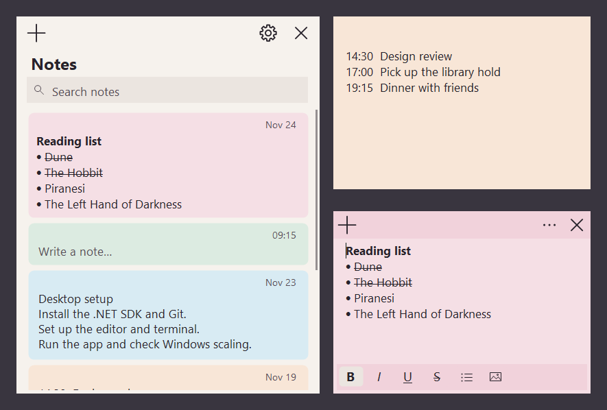

# NotepadApp

NotepadApp is a Windows desktop app for keeping sticky notes. Write in independent post-it windows, find notes from a searchable list, and keep everything on your device.

## Screenshot



## Download for Windows

Open the [latest release](https://github.com/Ohualtex/NotepadApp/releases/latest). Under **Assets**, download the file ending in `-win-x64.zip`. Extract the entire ZIP, then open `NotepadApp.exe`. The package includes the .NET runtime.

## Run from source

Install the .NET 10 SDK on Windows. From the repository root, run

```powershell
dotnet run --project NotepadApp.csproj
```

The app uses C#, Windows Forms, and the .NET standard library.

## Use the app

- Select **+** in the list or a post-it to create a note. The new note opens ready to type.
- Drag a post-it by its top bar and resize it from its edges. Each note remembers its own position and size. The top bar slides into view when the note gains focus and slides away when it loses focus. The formatting toolbar appears on the active note.
- Select a card to open its note or bring it forward. Hover over a card and select **⋯** to open or delete the note from the list.
- Cards are sorted by last edit and show up to five lines of content. The top-right corner shows the creation time for notes less than 24 hours old and the month and day for older notes.
- Scroll through the list with the mouse wheel or drag the thin scrollbar at the right edge.
- Drag the notes list by the empty space in the top bar and resize it from the edges. The list remembers its position and size.
- Closing the list leaves open notes on your desktop. Use **⋯ → Notes list** from a post-it to bring it back.
- Search by title or text with **Ctrl+F**. Matches are highlighted in the cards, including rich-text previews. Press **Esc** while the search box has focus to clear it.
- Use the formatting toolbar for bold, italic, underline, strikethrough, and bullets. Use the image icon to insert a picture at the cursor.
- Open **⋯** for note colors, **Notes list**, and **Delete note**.
- Open the gear in the list to choose **Light**, **Dark**, or **System** and control whether deleting a note asks for confirmation. **Local storage** contains **Save all**, **Reload**, and **Export all notes (.txt)**.

## Local storage

Changes save automatically after a short pause. Use **Settings → Local storage → Save all** to write changes immediately or retry after an error.

To export all notes, open **Settings → Local storage → Export all notes (.txt)**. The app writes all note titles and plain text to one UTF-8 file in last-edited order, including notes hidden by a search.

| File | Contents |
| --- | --- |
| `%LOCALAPPDATA%\NotepadApp\notes.json` | Note text, formatting, embedded images, colors, timestamps, and window positions and sizes |
| `%LOCALAPPDATA%\NotepadApp\settings.json` | Theme, delete confirmation, and the position and size of the notes list window |

If the notes file cannot be read, NotepadApp reports the error and disables saving. Repair the file or move it to a backup location, then choose **Settings → Local storage → Reload**.

## Project structure

| Files | Role |
| --- | --- |
| `Program.cs`, `NotepadApp.csproj` | Application entry point and WinForms project settings |
| `TaskbarAppearance.cs`, `Assets/Taskbar.ico` | Windows taskbar icon and shell integration |
| `NotesForm.cs`, `BufferedNoteList.cs`, `NoteSearch.cs` | Note list, card actions, buffered pixel scrolling, search, and coordination of open editors |
| `NotePreviewRenderer.cs`, `NoteRichContent.cs` | Cached previews that preserve formatting, images, and search highlights |
| `NoteEditorForm.cs`, `NoteOptionsPanel.cs`, `ResizableNoteWindow.cs` | Post-it editor, in-note panel, and resizable window frame |
| `NotesSettingsView.cs`, `AppPreferences.cs`, `NotesTheme.cs` | Settings UI, user preferences, and light/dark palettes |
| `Note.cs`, `NoteWindowPlacement.cs`, `NoteStore.cs` | Note model, saved window geometry, JSON persistence, and text export |
| `NoteButtons.cs`, `NotePalette.cs`, `RichTextFormatting.cs`, `NoteImage.cs` | Shared controls, note colors, text formatting, and image embedding |
